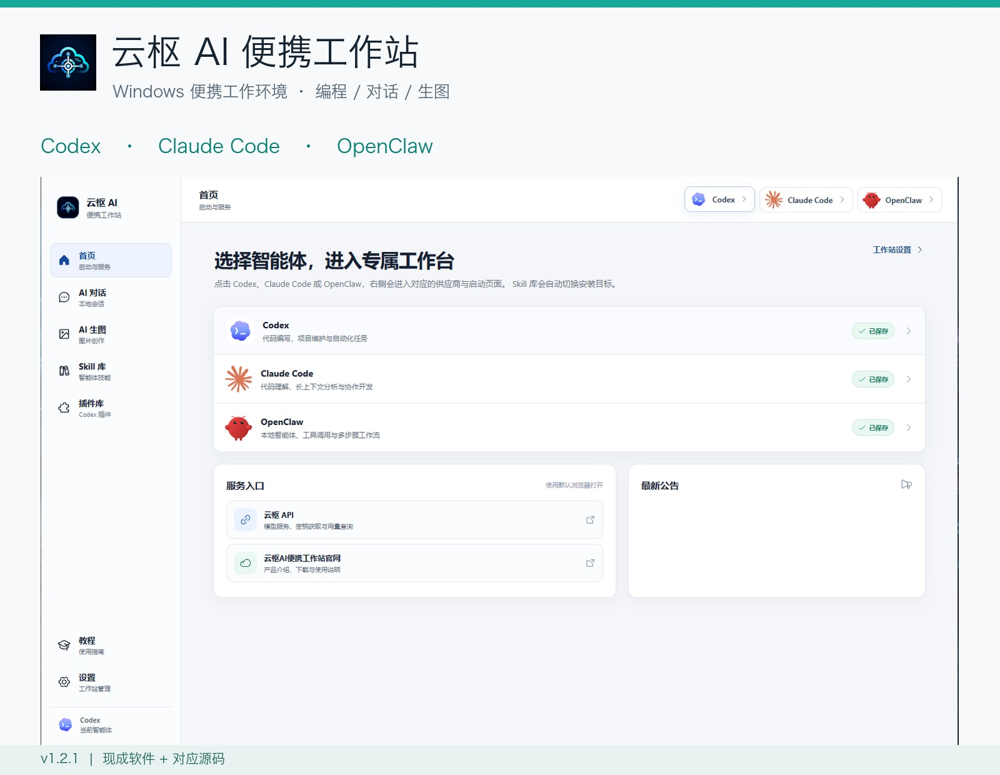
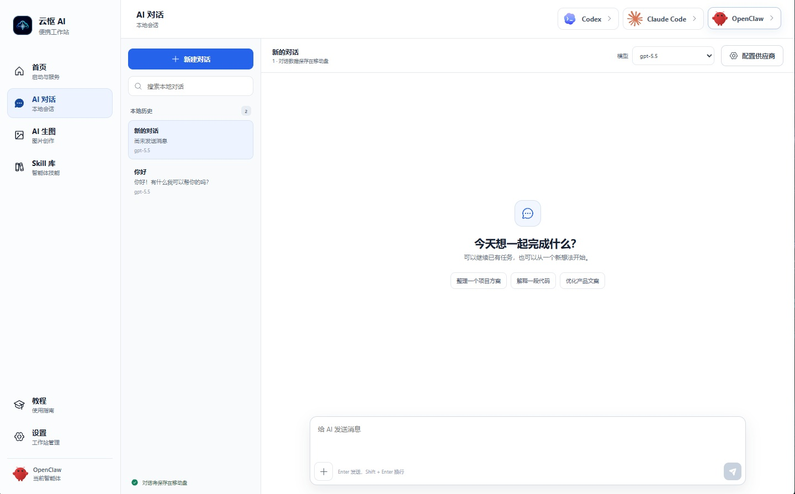
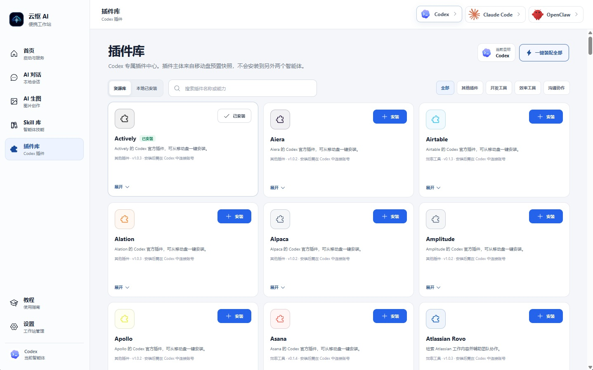
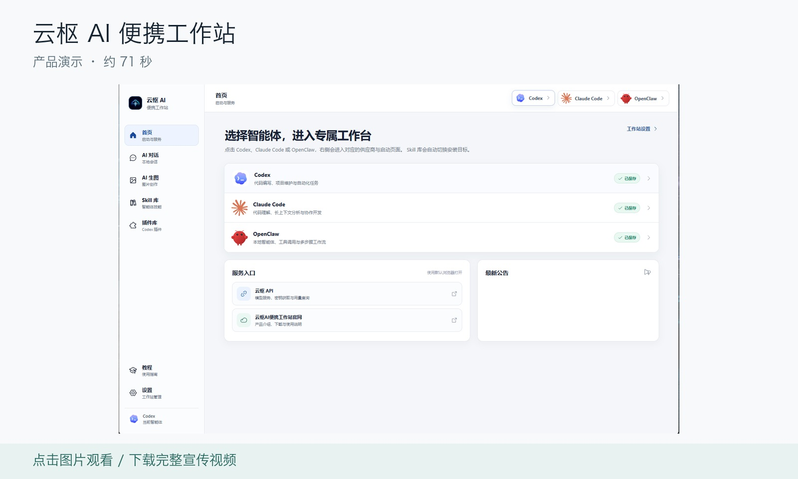

**English** | [简体中文](README.zh-CN.md)

# Yunshu AI Workstation · 云枢 AI 便携工作站

**A portable workspace for coding, conversations, image creation and your project files.**

Windows x64 · Codex / Claude Code / OpenClaw · v1.2.1

[**Download / 下载**](https://github.com/JJames646/codex-portable/releases/download/v1.2.1/Yunshu-AI-Workstation-1.2.1-Windows-x64.zip) · [**Video / 视频**](https://github.com/JJames646/codex-portable/releases/download/v1.2.1/Yunshu-AI-Workstation-Demo.mp4) · [**Source / 源码**](https://github.com/JJames646/codex-portable-workstation)

> **The ready-to-use software requires an activation code. Join QQ group `713993476` to request a free workstation activation code.**
>
> You can also search for **"云枢 AI"** on Xianyu (闲鱼) for inquiries. A workstation activation code is separate from a model API key. Configure your own model service; usage fees and quotas depend on your provider.

## Download and Get Started

| What you need | Where to find it |
| --- | --- |
| Windows installer v1.2.1 | [Download the ZIP, extract it and run the EXE](https://github.com/JJames646/codex-portable/releases/download/v1.2.1/Yunshu-AI-Workstation-1.2.1-Windows-x64.zip) |
| Release notes and checksums | [Open the v1.2.1 release](https://github.com/JJames646/codex-portable/releases/tag/v1.2.1) |
| Workstation and installer source | [Browse the release source](https://github.com/JJames646/codex-portable-workstation/tree/yunshu-v1.2.1) · [Download the source archive](https://github.com/JJames646/codex-portable/releases/download/v1.2.1/Yunshu-AI-Workstation-1.2.1-Source.zip) |
| Product video | [Watch / download the MP4](https://github.com/JJames646/codex-portable/releases/download/v1.2.1/Yunshu-AI-Workstation-Demo.mp4) |
| Free activation code requests and community support | **QQ group: 713993476** |

1. Download and extract the archive, then run `云枢AI便携工作站一键安装包-1.2.1.exe`.
2. Choose a writable folder on your computer, USB drive or portable SSD, and follow the installation wizard.
3. Allow initialization to finish on first launch, then activate the workstation using the code requested for free in the QQ group.
4. Configure your model service and API key as needed, then open Codex, Claude Code, OpenClaw, AI Chat or Image Generation.

The packaged application targets Windows 10/11 x64. A portable SSD is recommended. Model calls require an internet connection; third-party engines may have their own sign-in and system requirements. This repository does not provide packaged applications for macOS, Linux or Windows ARM.

**Interface language:** The current application, screenshots and promotional video are in Simplified Chinese. The project README is available in English and Chinese.

## What You Can Do

| Workflow | Available capabilities |
| --- | --- |
| AI coding and automation | Configure and launch Codex, Claude Code and OpenClaw from one workspace |
| Conversations and image creation | Local conversations, separate model service settings, image generation and result management |
| Skills and plugins | Browse resources, manage installations and switch the target engine |
| Portable project files | Keep projects, configuration and transferable data on your portable drive |
| Setup and maintenance | Chinese tutorials, workstation settings and an installation wizard |

### AI Chat

### Skills and Plugins

| Skills library | Plugin library |
| --- | --- |
|  |  |

## Product Video

Approximately 71 seconds, 1080p MP4. The screenshots and video show the existing product. The interface, available models and third-party resources depend on the installed version and service configuration.

## Version and Source

This download is **v1.2.1, built on September 20, 2026**, with workstation Build ID `9303dc9771b80694`. The existing installer was losslessly wrapped in a ZIP archive. The EXE, activation mechanism and model integration behavior were not changed.

- [Version verification and checksums (Chinese)](docs/releases/v1.2.1.md)
- [Source and build guide (Chinese)](https://github.com/JJames646/codex-portable-workstation/blob/yunshu-v1.2.1/docs/BUILD_YUNSHU.md)
- [Open-source scope and third-party notices (Chinese)](https://github.com/JJames646/codex-portable-workstation/blob/yunshu-v1.2.1/docs/OPEN_SOURCE.md)

This repository provides **software downloads, product media and usage information**. The [`codex-portable-workstation`](https://github.com/JJames646/codex-portable-workstation) repository provides the **corresponding source code**. Early architecture and prototype documents remain in their original locations and in Git history; they may not describe the current application.

## Feedback and Contact

For community support and free workstation activation code requests, join **QQ group 713993476**. You can also report problems in [Issues](https://github.com/JJames646/codex-portable/issues). Include the version, steps to reproduce and error message; do not post activation codes, API keys or personal conversation data.

Yunshu is an independent project. Codex, Claude Code, OpenClaw and other third-party names and logos belong to their respective owners. This project is not an official product of, or endorsed by, those vendors. Third-party software and services are subject to their own terms.
